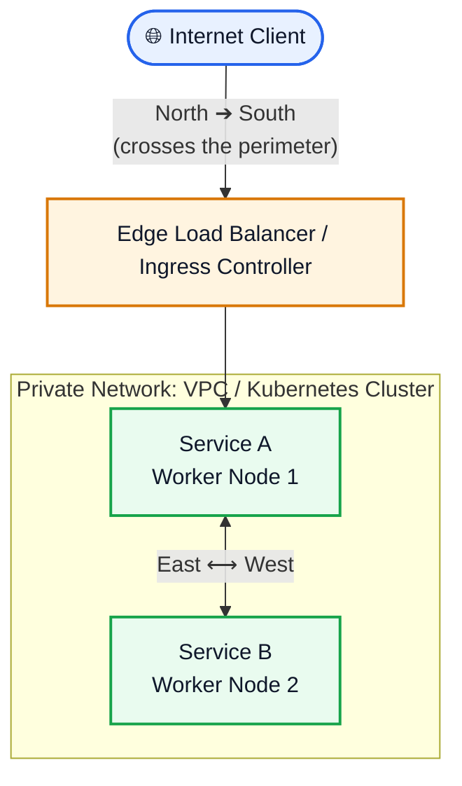
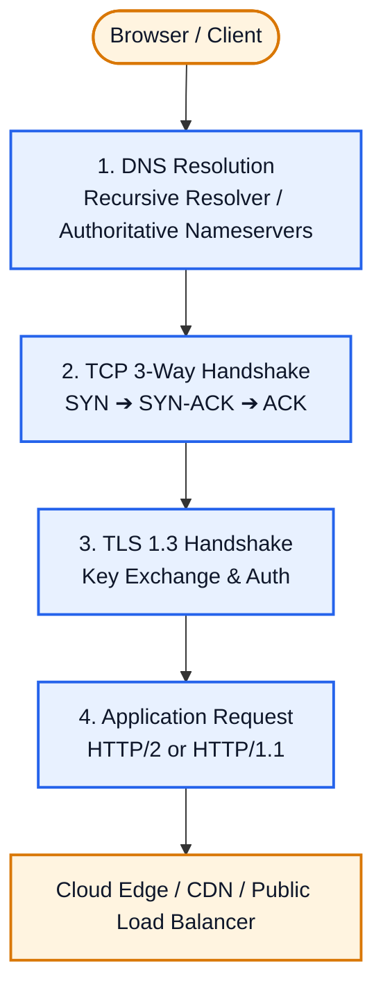
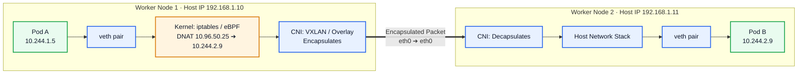
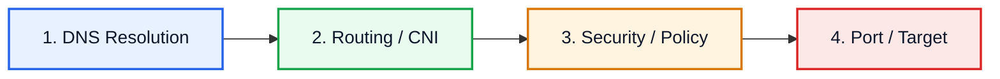
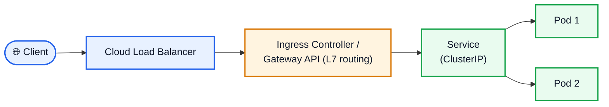

# The Mental Model of Networking: "Someone Wants to Talk to Someone"

   

Networking at its core is simply:

> **Someone wants to talk to someone else.**

Every single packet flow—from a browser loading a website to a microservice querying a database—must answer three fundamental questions:

1. **Identity & Resolution:** *Who am I talking to, and what is their current address?*
2. **Reachability & Routing:** *What path must the packet take to get there and back?*
3. **Agreement & Protocol:** *What rules must both sides speak so the payload is understood?*

---

## 📑 Contents

|   #   | Section                                                                          | You will learn                                     |
| :---: | :------------------------------------------------------------------------------- | :------------------------------------------------- |
|   –   | [The DevOps Nuance](#the-devops-nuance-north-south-vs-east-west)                 | Why East-West traffic is where most incidents live |
|   1   | [North-South Flow](#1-north-south-flow-the-public-web)                           | DNS ➔ TCP ➔ TLS ➔ HTTP                             |
|   2   | [East-West Flow](#2-east-west-flow-inside-the-kubernetes-cluster)                | CoreDNS, ClusterIP, DNAT, CNI                      |
|   3   | [Troubleshooting Playbook](#3-the-devops-troubleshooting-playbook)               | A layer-by-layer way to isolate failures           |
|   4   | [Entering the Cluster](#4-entering-the-cluster-services-ingress-and-gateway-api) | Service types, Ingress, Gateway API                |
|   5   | [Network Policies](#5-network-policies-the-firewall-inside-the-cluster)          | Default-deny and the DNS trap                      |
|   6   | [Classic Gotchas](#6-classic-gotchas-that-cause-real-outages)                    | `ndots`, MTU, conntrack, VXLAN ports               |
|   7   | [Debugging Toolkit](#7-the-debugging-toolkit)                                    | Commands and tools to reach for                    |
|   8   | [Key Takeaways](#8-key-takeaways)                                                | One-page cheat sheet                               |

---

## The DevOps Nuance: North-South vs. East-West

The classic interview question (*"What happens when you type a URL into a browser?"*) tests your understanding of **North-South traffic** (traffic crossing the network perimeter from the outside world into your infrastructure).

In modern Cloud and DevOps engineering, however, **over 80% of network operations and outages involve East-West traffic** (traffic flowing internally between microservices, containers, or worker nodes inside a VPC or Kubernetes cluster).



---

## 1. North-South Flow: The Public Web

When an external user visits `https://api.example.com/checkout`, the traffic flows through four primary phases:



### Phase 1: Address Resolution (DNS)

- The client knows the human-readable domain name (`api.example.com`), but cannot route packets without an IP address.
- The operating system checks local browser cache, OS resolver cache, and the local hosts file (`/etc/hosts`).
- If unresolved, the request is forwarded to the recursive resolver specified in `/etc/resolv.conf`.
- The resolver traverses root nameservers (`.`), TLD nameservers (`.com`), and authoritative nameservers to return an **A record** (IPv4) or **AAAA record** (IPv6).

### Phase 2: Transport Layer Handshake (TCP)

Before application data can travel, a reliable transport connection is established via the **TCP 3-Way Handshake**:

1. **SYN:** The client sends an initial sequence number ($ISN_c$) to initiate the session.
2. **SYN-ACK:** The server acknowledges the request ($ACK = ISN_c + 1$) and provides its own initial sequence number ($ISN_s$).
3. **ACK:** The client acknowledges the server's sequence number ($ACK = ISN_s + 1$). The connection moves to the `ESTABLISHED` state.

### Phase 3: Cryptographic Negotiation (TLS 1.3)

With TCP established, the security layer encrypts the connection:

1. **Client Hello:** Sends supported cipher suites and an ephemeral key share (Diffie-Hellman parameters).
2. **Server Hello:** Selects the cipher suite, sends its ephemeral key share, and provides its x509 digital certificate.
3. **Certificate Validation:** The client verifies the certificate against local trusted Certificate Authorities (Root CAs).
4. **Session Key Generation:** Both client and server compute matching symmetric encryption keys. Application traffic is now fully encrypted.

### Phase 4: Application Request (HTTP)

The client sends the encrypted HTTP payload:

```http
GET /v1/checkout HTTP/2
Host: api.example.com
Authorization: Bearer <token>
```

The public load balancer or CDN terminates TLS, processes routing rules, and forwards the packet into the private network.

---

## 2. East-West Flow: Inside the Kubernetes Cluster

Once a request enters your cluster, it becomes **East-West traffic**.

Consider a standard scenario: **Pod A** (frontend) needs to communicate with **Pod B** (backend) through a Kubernetes Service named `backend-svc`.



### Step 1: Internal DNS Resolution (CoreDNS)

- Pod A calls: `http://backend-svc.default.svc.cluster.local`.
- Pod A's `/etc/resolv.conf` directs queries to the cluster DNS IP (typically `10.96.0.10`).
- CoreDNS resolves the name and returns the **ClusterIP VIP** (e.g., `10.96.50.25`).

> [!NOTE]
> For standard services, CoreDNS returns the ClusterIP, not individual Pod IPs. (If you configure a **Headless Service** with `clusterIP: None`, CoreDNS bypasses the VIP and returns the Pod IPs directly).

### Step 2: The ClusterIP Illusion & Destination NAT (DNAT)

- A ClusterIP is **not** a physical interface, virtual device, or MAC address. You cannot ping it directly. It exists solely as in-memory routing rules managed by `kube-proxy` (using `iptables` or IPVS) or an eBPF program (such as Cilium).
- When Pod A sends a TCP SYN packet to `10.96.50.25:80`:
  - The packet exits Pod A's network namespace through a virtual ethernet interface (`veth`).
  - The packet hits the host kernel's networking stack (`PREROUTING`).
  - The kernel executes **Destination NAT (DNAT)**, rewriting the destination from the Service VIP (`10.96.50.25:80`) to a specific healthy backend Pod (e.g., Pod B at `10.244.2.9:8080`).
  - The host kernel's `conntrack` (connection tracking) table records this translation so it can reverse it when responses return.

### Step 3: Container Network Interface (CNI) Cross-Node Routing

- The kernel must now deliver the packet to destination IP `10.244.2.9`, which is located on Worker Node 2.
- The CNI plugin (e.g., Cilium, Calico, AWS VPC CNI, Flannel) moves the packet across the physical network:
  - **Overlay Network (e.g., VXLAN, Geneve):** Node 1 encapsulates the original Pod packet inside an outer UDP packet (Outer Source: `192.168.1.10`, Outer Dest: `192.168.1.11`, Port: `8472`).
  - **Direct / Routed Network (e.g., AWS VPC CNI, Calico BGP):** The underlying cloud VPC or physical switches natively recognize Pod IP ranges. Packets travel directly over the wire without encapsulation overhead.

> [!WARNING]
> Port `8472` is the Linux kernel default used by Flannel and Cilium. The IANA-standard VXLAN port is `4789`, which Calico uses. Always open the port your CNI actually uses between nodes.

### Step 4: Ingress into Pod B & Symmetric Response

- Node 2 receives the packet on its physical network interface (`eth0`).
- If overlay encapsulation was used, the CNI strips the outer UDP wrapper.
- The kernel routes the packet through the target virtual interface (`veth`) into Pod B's network namespace.
- Pod B accepts the connection and returns a SYN-ACK.
- When the response packet reaches Node 1, `conntrack` rewrites the source IP back to the original ClusterIP VIP (`10.96.50.25`). Pod A never knows it communicated directly with Pod B's internal IP.

---

## 3. The DevOps Troubleshooting Playbook

When an outage occurs, apply the mental model to isolate which layer failed:



| Layer / Problem                                                | North-South Verification                                                                 | East-West (Kubernetes) Verification                                                                                                                                                                        |
| :------------------------------------------------------------- | :--------------------------------------------------------------------------------------- | :--------------------------------------------------------------------------------------------------------------------------------------------------------------------------------------------------------- |
| **"I don't know who they are"**<br>*(DNS Failure)*             | • `dig +trace api.example.com`<br>• `nslookup api.example.com`                           | • `kubectl exec -it <pod> -- nslookup backend-svc`<br>• Check CoreDNS logs: `kubectl logs -n kube-system -l k8s-app=kube-dns`<br>• Inspect `/etc/resolv.conf` inside the pod                               |
| **"I have the IP, but cannot route"**<br>*(Routing / CNI)*     | • `traceroute <ip>`<br>• `ping <ip>`                                                     | • Check CNI daemonset logs (Calico, Cilium, Flannel)<br>• Verify worker-to-worker security groups allow UDP 8472 (VXLAN) or IP-in-IP<br>• Check for MTU mismatches causing packet drops                    |
| **"Packets are being dropped"**<br>*(Firewall / Policies)*     | • Cloud Provider Security Groups<br>• Subnet NACLs<br>• Edge WAF rules                   | • Check NetworkPolicy objects: `kubectl get netpol -A`<br>• Inspect host `iptables`/eBPF drop metrics                                                                                                      |
| **"Port is unreachable / rejected"**<br>*(Connection Refused)* | • `curl -Iv https://api.example.com`<br>• Check Load Balancer target group health checks | • Check Service endpoints: `kubectl get endpoints backend-svc`<br>• Verify Pod `targetPort` matches the container's listening port<br>• Ensure the process binds to `0.0.0.0`, not `127.0.0.1`: `ss -tlpn` |

### Systematic Debugging Checklist

When debugging an unfamiliar networking error:

1. **Identify the initiator:** What entity is sending the packet?
2. **Identify the target:** Is the target an IP, a DNS name, or a virtual abstraction (like a ClusterIP)?
3. **Verify resolution:** Did the initiator receive the correct address from DNS?
4. **Verify transport:** Did the packet leave the node? Is the CNI encapsulation working?
5. **Verify authorization:** Did a security group, firewall, or NetworkPolicy drop the packet?
6. **Verify listener:** Is the application actually running and listening on the designated port?

---

## 4. Entering the Cluster: Services, Ingress and Gateway API

North-South traffic does not stop at the cloud load balancer. It must still find its way to a Pod, and that is where the two worlds meet.



### Service types at a glance

| Type                             | Reachable from                 | How it works                                           | Typical use                                      |
| :------------------------------- | :----------------------------- | :----------------------------------------------------- | :----------------------------------------------- |
| **ClusterIP**                    | Inside the cluster only        | Virtual IP translated by kube-proxy or eBPF            | Service-to-service (East-West)                   |
| **Headless** (`clusterIP: None`) | Inside the cluster only        | DNS returns Pod IPs directly                           | StatefulSets, client-side load balancing         |
| **NodePort**                     | Anywhere that can reach a node | Opens a port (30000-32767) on every node               | Simple exposure, or a target for a load balancer |
| **LoadBalancer**                 | Public or private network      | Provisions a cloud load balancer in front of the nodes | Exposing one service directly                    |
| **ExternalName**                 | Inside the cluster only        | DNS `CNAME` to an external hostname                    | Pointing at a managed database or SaaS           |

### Ingress vs. Gateway API

- **Ingress** routes HTTP(S) traffic to Services through an Ingress controller. The API is stable but frozen.
- **Gateway API** is the actively developed successor, with a role-oriented model (`GatewayClass`, `Gateway`, `HTTPRoute`) that separates platform concerns from application routing.
- Both operate at **Layer 7**: they read hostnames and paths, terminate TLS, and then hand traffic to a Service, after which the East-West rules from section 2 apply.

---

## 5. Network Policies: The Firewall Inside the Cluster

By default, Kubernetes allows every Pod to talk to every other Pod. NetworkPolicies change that.

- Policies are **additive**: they only ever allow traffic, never explicitly deny it.
- Once a Pod is selected by a policy for a direction (ingress or egress), everything not explicitly allowed in that direction is dropped.
- Policies are enforced by the **CNI**, so a CNI without policy support (plain Flannel, for example) silently ignores them.

A common starting point is a default-deny for a namespace, followed by explicit allows:

```yaml
apiVersion: networking.k8s.io/v1
kind: NetworkPolicy
metadata:
  name: default-deny-all
  namespace: prod
spec:
  podSelector: {}
  policyTypes:
    - Ingress
    - Egress
```

> [!IMPORTANT]
> Once you deny egress, Pods can no longer reach CoreDNS. Add an egress rule allowing UDP and TCP port `53` to the `kube-system` namespace, or every name lookup will fail and it will look like a DNS outage.

---

## 6. Classic Gotchas That Cause Real Outages

| Symptom                                                  | Likely cause                                                                                          | What to check                                                                                 |
| :------------------------------------------------------- | :---------------------------------------------------------------------------------------------------- | :-------------------------------------------------------------------------------------------- |
| Slow or flaky lookups for external names                 | `ndots:5` in the Pod's `/etc/resolv.conf` makes the resolver try several cluster search domains first | Use a fully qualified name with a trailing dot (`example.com.`) or tune `dnsConfig`           |
| Small requests work, large ones hang                     | **MTU mismatch**: VXLAN adds about 50 bytes of overhead, so full-size packets get dropped             | Compare MTU on Pod, node and tunnel interfaces; lower the Pod MTU if needed                   |
| Random connection failures under heavy load              | **conntrack table full**                                                                              | Look for `nf_conntrack: table full, dropping packet` in kernel logs; raise `nf_conntrack_max` |
| Service has no backends                                  | Selector mismatch or Pods failing readiness checks                                                    | `kubectl get endpointslices -l kubernetes.io/service-name=backend-svc`                        |
| `connection refused` from another Pod, but works locally | App bound to `127.0.0.1` instead of `0.0.0.0`                                                         | `ss -tlpn` inside the Pod                                                                     |
| Cross-node traffic fails, same-node works                | Node firewall or security group blocks the overlay port                                               | Open UDP `8472` or `4789` (depending on CNI) between nodes                                    |

---

## 7. The Debugging Toolkit

Most application images ship without networking tools. Use a throwaway debug container instead of installing tools into production images.

```bash
# Temporary Pod with a full networking toolbox
kubectl run netshoot --rm -it --image=nicolaka/netshoot -- bash

# Attach a debug container to an existing Pod
kubectl debug -it <pod> --image=nicolaka/netshoot --target=<container>
```

| Question                  | Command                                                    |
| :------------------------ | :--------------------------------------------------------- |
| What does DNS return?     | `dig backend-svc.default.svc.cluster.local`                |
| Is the port open?         | `curl -v http://backend-svc:80` or `nc -zv backend-svc 80` |
| What is listening?        | `ss -tlpn`                                                 |
| Where does the packet go? | `ip route get 10.244.2.9`                                  |
| Is NAT happening?         | `conntrack -L \| grep 10.96.50.25`                         |
| What is on the wire?      | `tcpdump -i any -nn host 10.244.2.9`                       |
| What did the CNI drop?    | `hubble observe --verdict DROPPED` (Cilium)                |

---

## 8. Key Takeaways

> [!TIP]
> Keep the three questions in mind during every incident: **who** am I talking to, **how** do I get there, and **what** rules apply?

1. **Most incidents are East-West.** Learn how Pods, Services and the CNI behave before reaching for exotic tools.
2. **A ClusterIP is an illusion.** It is only DNAT rules, so you cannot ping it, and you debug the rules, not a device.
3. **Work in order:** DNS ➔ routing ➔ policy ➔ port. Skipping layers wastes time.
4. **Policies and CNIs are coupled.** A policy your CNI does not enforce protects nothing.
5. **Check the boring things first:** bind address, `targetPort`, endpoints, MTU and DNS.

### One-page cheat sheet

| Layer    | Fastest check                                     |
| :------- | :------------------------------------------------ |
| DNS      | `kubectl exec <pod> -- nslookup backend-svc`      |
| Service  | `kubectl get endpoints backend-svc`               |
| Policy   | `kubectl get netpol -A`                           |
| Listener | `ss -tlpn` inside the Pod                         |
| Overlay  | Open node-to-node UDP `8472` / `4789`, verify MTU |